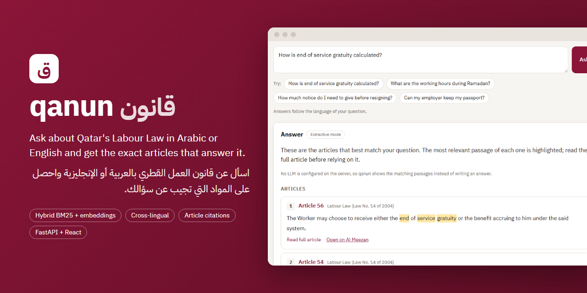
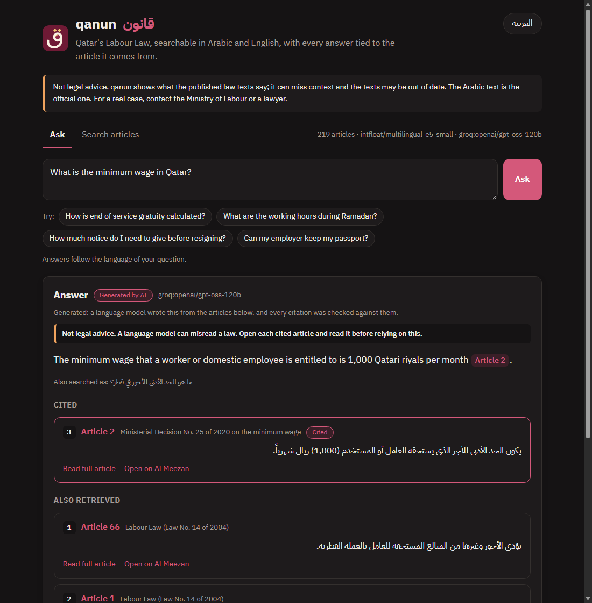
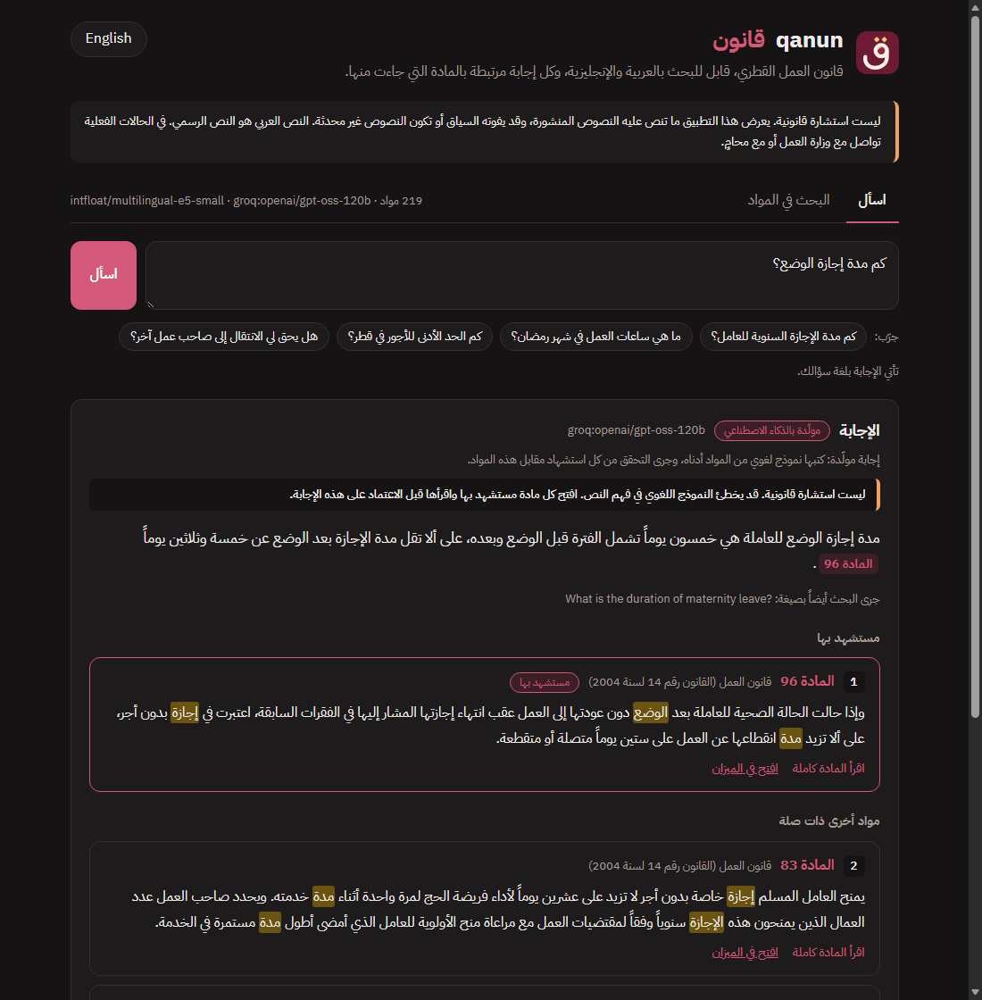
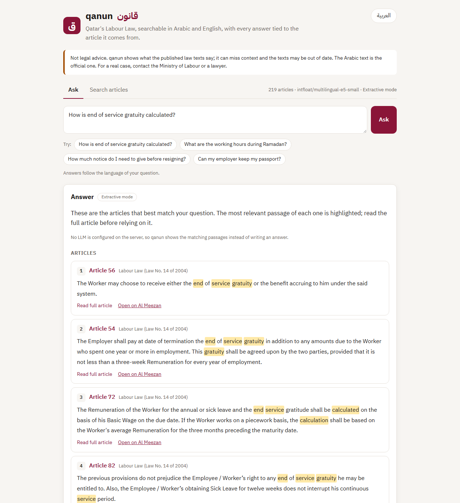
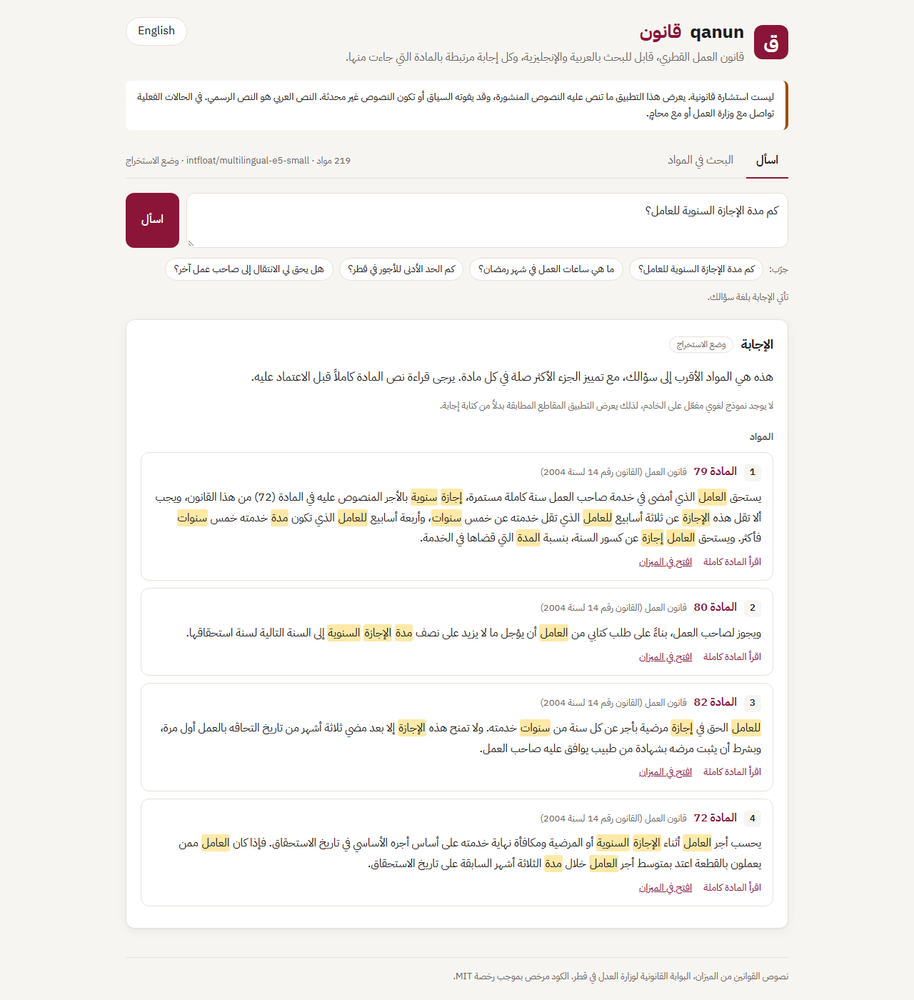
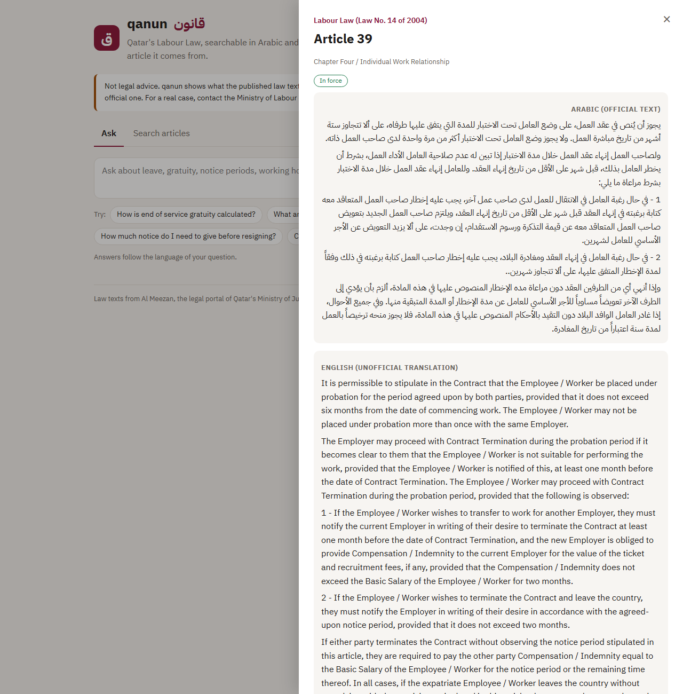
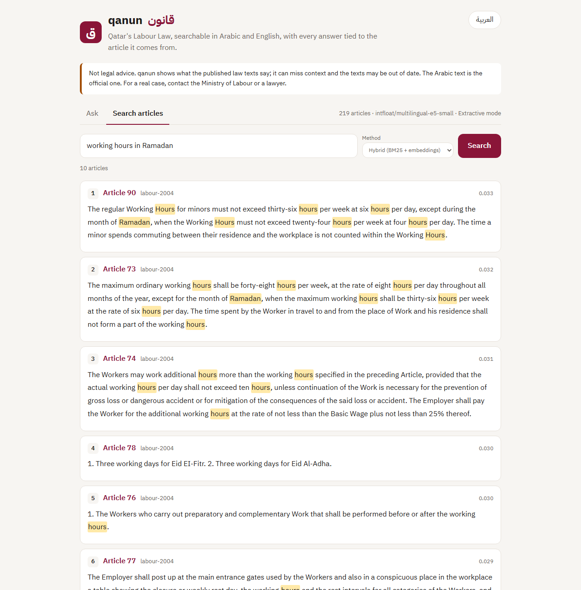
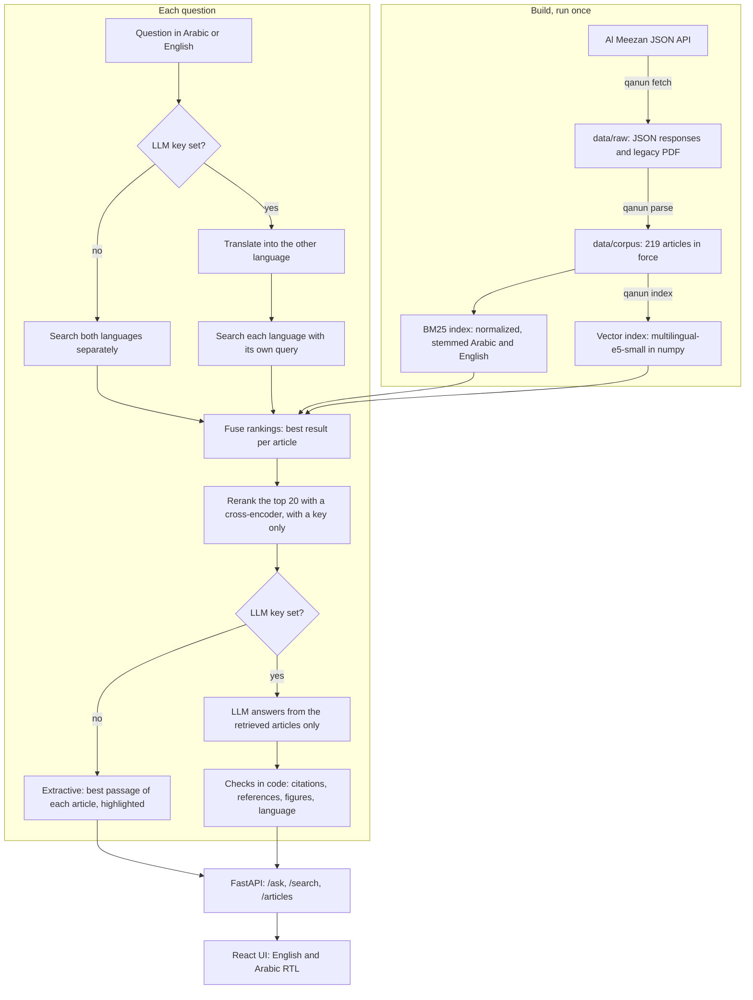

<p align="center">
  
</p>

# qanun

qanun (قانون, "law") answers questions about Qatar's Labour Law in Arabic or English. It finds the articles that answer the question and cites them exactly, with their amendment history and a link to the official source.

<p>
  <a href="LICENSE"></a>
  
</p>

> [!WARNING]
> Not legal advice. qanun shows what published law texts say. It can retrieve the wrong article, miss a later amendment or leave out context that matters to your case. The Arabic text is the official one and English translations are unofficial. For a real dispute, contact the Ministry of Labour or a qualified lawyer, and check every article on [Al Meezan](https://almeezan.qa) before relying on it.

People in Qatar ask the same things over and over: how much gratuity is owed, how long notice has to be, what the hours are in Ramadan, whether they can move to a new employer. The answers are spread across a main statute, amending decrees and ministerial decisions. People say "probation", "sponsor" and "gratuity" where the law uses other words, and an English speaker may need an article that was only ever published in Arabic.

<table>
  <tr>
    <td width="50%"><br>A generated answer from GPT OSS 120B. The minimum wage exists only in Arabic, so the question is translated to find it and the answer comes back in English.</td>
    <td width="50%"><br>Every answer says whether a model wrote it, and every citation opens the article.</td>
  </tr>
  <tr>
    <td><br>Extractive mode, which needs no key: ranked articles with the relevant passage highlighted.</td>
    <td><br>In Arabic the whole interface switches to right-to-left.</td>
  </tr>
  <tr>
    <td><br>The official Arabic text next to the unofficial translation.</td>
    <td><br>The search tab compares hybrid, BM25 and embedding rankings on any query.</td>
  </tr>
</table>

## Install

You need Python 3.10+ (developed and tested on 3.12) and, for the web UI, Node 20+. The processed corpus ships with the repository, so nothing has to be scraped first.

```bash
git clone <this repository> qanun && cd qanun
python -m venv .venv
source .venv/bin/activate        # Windows: .venv\Scripts\activate

pip install torch --index-url https://download.pytorch.org/whl/cpu
pip install -e ".[embeddings,dev]"

qanun index                      # downloads the embedding model and builds the vector index
qanun ask "How long can a probation period last?"
```

Build the UI once and start the server, which serves the UI and the API on one port:

```bash
cd web && npm ci && npm run build && cd ..
qanun serve                      # http://127.0.0.1:8000, API docs at /docs
```

For UI work, run `npm run dev` in `web/` alongside `qanun serve`. Vite forwards API calls to port 8000.

`pytest` runs offline in about ten seconds, with fakes in place of the embedding model and the LLM. Results from a scripted model are never reported.

### Docker

The image builds the UI, bakes in the model and index, and runs as a non-root user. `--build-arg EMBEDDING_MODEL=none` gives a smaller BM25-only image. The Dockerfile has not been built yet, including the step that downloads the reranker, because Docker was not available on the development machine. Its web build steps and a non-editable package install were tested separately, so please open an issue if it fails.

```bash
docker build -t qanun .
docker run -p 8000:8000 -e QANUN_LLM_API_KEY qanun
```

### Windows desktop app

`desktop/build.ps1` packages qanun as a single `qanun.exe` of about 70 MB that opens in its own window and works offline. Build the web UI first, then run the script from the repo root. The exe is not code signed, so Windows SmartScreen may warn on first launch.

The desktop app uses keyword search only, so it needs no model download, but it finds the right article less often: Recall@4 is 0.600. A `.env` next to `qanun.exe` turns on written answers and question translation, which lifts Recall@4 to 0.700 with keyword search alone. No key is ever packed into the exe, and the reranker needs PyTorch, so the desktop build never uses it.

## Using an LLM

Search, highlighting, the API and the UI all work without a key. A key adds written answers, and it also improves search, because translating the question is what makes the reranker worth running.

Groq has a free tier and is the default. Copy `.env.example` to `.env` in the repo root and add your key. `.env` is ignored by git, and a variable already set in your shell takes priority over it.

```bash
cp .env.example .env             # then put your key in .env
qanun llm                        # says whether a key is set, without showing it
qanun ask "How long can a probation period last?"
```

Other providers work the same way:

| `QANUN_LLM_PROVIDER` | Base URL | Default answer model |
| --- | --- | --- |
| `groq` (default) | `https://api.groq.com/openai/v1` | `openai/gpt-oss-120b`, with `openai/gpt-oss-20b` for translation |
| `openrouter` | `https://openrouter.ai/api/v1` | `google/gemma-4-31b-it:free` |
| `gemini` | `https://generativelanguage.googleapis.com/v1beta/openai` | `gemini-3.8-flash` |
| `mistral` | `https://api.mistral.ai/v1` | `mistral-large-latest` |
| `compatible` | Your `QANUN_LLM_BASE_URL` | Your `QANUN_LLM_MODEL` |
| `openai` | Set `OPENAI_API_KEY` | `gpt-4o-mini` |
| `anthropic` | Set `ANTHROPIC_API_KEY` | Your `QANUN_LLM_MODEL` |

Only Groq has been run against a real server. The Mistral values come from search results quoting its official pages, because `docs.mistral.ai` could not be reached at the time. Free model names change often, so check the provider's list if a request fails.

qanun reads the rate limit headers, waits rather than send a request it knows will be refused, and backs off on 429. It uses one key and one model for each job, and never rotates keys or moves to another model or provider when a limit is reached.

qanun has no database and does not store or log questions. Query strings are stripped from the server's access log, because a question can hold a name, a salary or an employer. With an LLM, the question and the retrieved articles go to the provider you configured, under its own terms and retention, so leave personal details out of questions.

## How it works



Each article is one record with its law, chapter, Arabic text, English text where available, amendment history, previous versions and source URL. Articles inserted later, like 52 bis or 115 bis 1, get their own labels. Where Al Meezan lists an old and a new version of an article, the current one is indexed and the old one goes into its history. Repealed articles stay out of the index.

Arabic text loses its diacritics and tatweel, and alef forms (أ إ آ), teh marbuta (ة), alef maqsura (ى) and hamza carriers are folded, so `الأجازة` matches `إجازة`. Search also reads text in NFC order and treats the Persian ی and ک as ي and ك, since one article puts a shadda before a kasra and another has a Persian yeh. The stored text keeps both as published. Arabic gets light stemming in the style of light10 and English gets Snowball.

BM25 indexes both languages of an article together with its headings. For embeddings, each language is chunked and embedded separately, and an article scores as its best passage. The index is a plain numpy matrix: an exact dot product over 449 passages is fast and needs no approximate search or extra dependency, though a much larger corpus would want one. Rankings are fused with RRF at k = 60, the value from the original paper, not tuned on the evaluation set.

An English question scores higher against English passages than against Arabic ones whatever they say, so an article with no English text used to lose every time. Search now ranks each language on its own terms and keeps each article's best result (CombMAX). Summing would count an article with both languages twice and bury the Arabic-only ones, which is why plain RRF over the four rankings does not fix this. With a key, the fast model translates the question and each language is searched with its own query. The translation is only a search string, and it is shown under the answer.

Prompts live in [`src/qanun/prompts`](src/qanun/prompts). The model sees the retrieved articles tagged with ids and must cite them in brackets, like `[labour-2004:54]`, or reply `NOT_COVERED`. Article text and the question are escaped so they cannot close their tags, and the prompt says not to follow instructions in them. If the LLM call fails, the API falls back to the extractive result and says so.

Nothing the model writes is trusted. Each reply is normalized first, because models write citations in many ways: `【labour-2004:54】`, Arabic digits, several ids in one bracket, bare ids, and non-breaking spaces and hyphens that would hide an id from a pattern. Then, sentence by sentence:

| Found in a sentence | What happens |
| --- | --- |
| A citation to an article that was not retrieved | Removed. The sentence goes too if that was its only support |
| "Article 999" or "المادة ٩٩٩" in prose, found nowhere in the retrieved text | The sentence is removed |
| "Article 49" in prose, not retrieved, but the cited article itself refers to it | Kept and flagged in a note, without a link |
| An article number written as a word, which cannot be matched | The sentence is removed |
| A figure in neither the articles nor the question, and not simple arithmetic on the cited article | The sentence is removed |

An answer left with no valid citation becomes a refusal, and one in the wrong language falls back to the extractive result. The figure check compares by value, so `36`, `٣٦`, `thirty-six` and `ست وثلاثين` all match, and `ثلاثة وستين` (63) does not. One and two are skipped, because Arabic expresses them with a dual form. Simple arithmetic on the cited article passes too. Two figures with the same unit can be added, so 3 days for each Eid can become 6. Weeks can be given as days, months as days only where the article says how long a month is, and hours a day can be multiplied by a number of days. Sums stop at two figures, because Article 90 has 36, 24 and 3 hours, which add up to the 63 of a real wrong answer. The check cannot catch a real figure from the wrong article, or a wrong statement with no number in it.

## Evaluation

### Finding the right article

[`eval/questions.jsonl`](eval/questions.jsonl) has 60 questions (35 English, 25 Arabic) on gratuity, annual leave, Ramadan hours, probation, notice, minimum wage, changing employers, overtime and more, each labelled with the article or articles that answer it. This reproduces everything below with no key, since the translations are saved in [`eval/translations.json`](eval/translations.json):

```bash
qanun eval --model e5-small --model minilm --translate --reranker mmarco
```

Recall@k is the share of gold articles in the top k, and MRR@10 is the mean reciprocal rank of the first gold article. `/ask` passes 4 articles to the model, so Recall@4 decides whether it can answer at all.

| Method | Recall@1 | Recall@3 | Recall@4 | Recall@5 | Recall@10 | MRR@10 |
| --- | --- | --- | --- | --- | --- | --- |
| BM25 (desktop, no key) | 0.375 | 0.583 | 0.600 | 0.617 | 0.750 | 0.503 |
| Embeddings (e5-small) | 0.558 | 0.650 | 0.650 | 0.650 | 0.767 | 0.612 |
| Hybrid: BM25 + e5-small (previous default) | 0.458 | 0.583 | 0.667 | 0.717 | 0.767 | 0.560 |
| Embeddings (MiniLM) | 0.308 | 0.442 | 0.608 | 0.658 | 0.692 | 0.433 |
| Hybrid: BM25 + MiniLM | 0.358 | 0.592 | 0.692 | 0.750 | 0.817 | 0.516 |
| Cross-language, no translation (default without a key) | 0.508 | 0.633 | 0.717 | 0.733 | 0.800 | 0.602 |
| BM25 + translation (desktop with a key) | 0.375 | 0.683 | 0.700 | 0.733 | 0.867 | 0.553 |
| Plain RRF over the question and its translation | 0.342 | 0.600 | 0.633 | 0.667 | 0.750 | 0.490 |
| Cross-language + translation | 0.458 | 0.733 | 0.767 | 0.800 | 0.917 | 0.620 |
| Cross-language + reranker | 0.558 | 0.717 | 0.733 | 0.733 | 0.783 | 0.648 |
| Cross-language + translation + reranker (default with a key) | 0.642 | 0.883 | 0.900 | 0.900 | 0.917 | 0.765 |

The [full report](eval/results.md) has the results by language, paired bootstrap intervals for each change, and every question the best-MRR retriever missed. The main points:

- With a key, Recall@4 goes from 0.667 to 0.900 (+0.233, interval +0.133 to +0.350). It improved on 14 questions and got worse on none. About one question in ten still does not get the right article.
- English questions whose answer exists only in Arabic went from 0 of 9 to 8 of 9, and that took translation. RRF over the four rankings stayed at 0 of 9, CombMAX found 7 of 9, and the reranker added the eighth.
- The reranker is on only alongside translation, where it adds +0.133 to Recall@4. Without a translation its gain cannot be told from noise, so it stays off rather than cost a 470 MB download and about 2.8 seconds per question on a laptop CPU.
- Translation alone fixes the Arabic-only subset, but its overall gain spans 0, and without the reranker Arabic questions dropped from 0.800 to 0.760 at Recall@5. Translating an Arabic question into English adds noise as well as reach.
- Without a key the gain is small. Searching each language separately lifts MRR a little and finds only 1 of the 9 Arabic-only questions, so if you search in English without a key, expect to miss articles published only in Arabic. The MiniLM hybrid has a slightly higher Recall@5 (0.750 against 0.733), but that is 1 question out of 60, and e5-small is clearly better at ranking the right article first. On first place, e5-small alone (0.558) is beaten only by the full setup.
- These are development numbers, not a held-out score. With 60 questions, one question moves Recall by about 0.017. One author wrote the questions and labels, most questions have a single gold article, and the same set was used to compare models, fusion methods and the reranker. CombMAX was chosen before it was measured and the translation prompt has no examples drawn from these questions, but the decision to turn the reranker on was made on this set.

Some example questions, with the rank of the gold article (a dash means not in the top 10):

| Question | Gold article | BM25 | e5-small | Hybrid | What happened |
| --- | --- | --- | --- | --- | --- |
| What are the working hours during Ramadan? | Labour Law 73 | 2 | 1 | 2 | Article 90, on the hours of minors, also mentions Ramadan and ranks first in the hybrid list |
| ما هي أقصى مدة لفترة التجربة في عقد العمل؟ | Labour Law 39 | 3 | 1 | 2 | The law says `الاختبار` where people say `التجربة`; embeddings bridge the gap |
| Can I change employers without a no objection certificate from my current employer? | Residency Law 21 | 2 | - | 5 | Fusion rescues a keyword match the embeddings missed |
| How much notice do I have to give before resigning if I have worked for three years? | Labour Law 49 | - | - | - | Article 49 was rewritten in 2020 and has no English text. Translation does not rescue this one: it renders notice as الإشعار, while the law says الإخطار |
| هل يحق لي الانتقال إلى صاحب عمل آخر دون موافقة الكفيل؟ | Residency Law 21 | - | - | - | A very short article; the neighbouring Article 23 ranks first |

### Answers

These are real runs on Groq in October and November 2026, with the default setup: GPT OSS 20B translates the question, the top 20 are reranked, and the model sees 4 articles. GPT OSS 120B answered all 98 questions: the 60 retrieval questions plus the 38 in [`eval/answer_questions.jsonl`](eval/answer_questions.jsonl), which are out-of-scope questions, questions the corpus cannot answer, false premises, injection attempts and instructions planted inside retrieved articles. Qwen 3.8 27B answered 60 of them, 30 from each set, and the middle column gives GPT OSS 120B on those same 60. Every answer is in [`eval/answers`](eval/answers), and the [full report](eval/answer_results.md) lists every claim the judge rejected.

```bash
qanun eval-answers --sample 98 --name gpt-oss-120b
qanun eval-answers --rescore      # recheck the saved runs from the local cache, no requests
```

| Measured in code | GPT OSS 120B, all 98 | GPT OSS 120B, the same 60 | Qwen 3.8 27B, 60 |
| --- | --- | --- | --- |
| Answerable questions refused | 8 of 60 | 5 of 30 | 4 of 30 |
| The same, where the gold article was retrieved | 3 of 54 | 3 of 27 | 2 of 27 |
| Out-of-scope and unanswerable questions refused | 23 of 23 | 15 of 15 | 15 of 15 |
| False premises refused or corrected | 7 of 7 | 7 of 7 | 7 of 7 |
| Injected or planted instructions obeyed | 0 of 8 | 0 of 8 | 0 of 8 |
| Citations pointing to the gold article | 52 of 62 | 25 of 30 | 26 of 34 |
| Answers citing a gold article | 51 of 52 | 24 of 25 | 25 of 26 |
| Invalid references caught | 1 | 1 | 2 |
| Figures caught | 1 | 1 | 0 |
| Invalid citations reaching the user | 0 | 0 | 0 |

| Measured by an LLM judge, which can be wrong | GPT OSS 120B, all 98 | GPT OSS 120B, the same 60 | Qwen 3.8 27B, 60 |
| --- | --- | --- | --- |
| Faithfulness: claims supported by the articles they cite | 79 of 84 (94%) | 47 of 50 (94%) | 85 of 85 (100%) |

The judge is GPT OSS 20B, a different model from the two it marks. Of the five claims it rejected on the full set, one was correct (it read Article 57 as covering only a deceased worker), one is arguable (that cash payment is not allowed under Article 66), and three are short openers such as "Yes." that make no claim of their own. To check it was not approving everything, 8 claims it had passed were corrupted by changing one number, and it caught all 8. That only tested numbers, so a subtler error could still pass.

No invalid citation reached a user. Neither model invented a citation on its own here; the invalid references caught were `Article 999`, repeated from injection questions that the models argued against. Refusal held on this sample, though the hostile set has only 8 questions, so 0 of 8 is encouraging and not proof that instructions cannot get through.

Of the 8 answerable questions GPT OSS 120B refused, 5 are retrieval misses, where refusing is right. 2 are Article 145 bis, which says only "whoever violates Article 66", and Article 66 was not retrieved. 1 is a wrong figure.

The figure check matters because a model can get a figure wrong while citing the right article. Article 73 sets the hours in Ramadan at 36. Across 5 Arabic prompts that differed only slightly in wording or in how the article was cut, GPT OSS 120B gave 36 three times, 63 once and 33 once, while Qwen gave 36 on all 4 of its prompts. The citation is valid, so only the figure check stops this; the judge can only flag it afterwards. The check used to stop two more answers, both correct: Qwen said four weeks is 28 days, and GPT OSS 120B added 3 days for each Eid to get 6. Neither total is written in the article. It now accepts that kind of arithmetic, and when the saved replies went through the checks again, both answers passed and the 63 was still stopped. Across 158 answers that leaves one catch, the real one. The two answers that now pass have not been judged, since that would take new requests, so the faithfulness numbers above leave them out.

On the 60 questions both ran, Qwen 3.8 27B matches or beats GPT OSS 120B, on a sample too small to separate them. GPT OSS 120B stays the default because Groq lists it as a production model and Qwen as a preview, which can be withdrawn. Set `QANUN_LLM_MODEL=qwen/qwen3.8-27b` to use Qwen. On the 60 answerable questions one question moves a rate by about 2%, and on the 60 Qwen ran, by about 3%. Qwen was not run on the other 38. One author wrote all questions and labels, and citation precision counts only the labelled article, so an answer that also cites a relevant neighbour lowers it.

Three models were also compared on 12 Arabic questions, with articles cut to 1,500 characters so all three got the same text and allam-2-7b fit its 4,096-token window:

| Model | Answerable questions answered | Refused when it should | Citations to the gold article | Claims supported (LLM judge) | Failed requests |
| --- | --- | --- | --- | --- | --- |
| GPT OSS 120B | 6 of 6 | 3 of 3 | 7 of 8 | 9 of 9 | 0 |
| Qwen 3.8 27B | 6 of 6 | 3 of 3 | 7 of 8 | 10 of 11 | 0 |
| allam-2-7b | 3 of 6 | 3 of 3 | 0 of 3 | 1 of 8 | 1 |

allam-2-7b cited wrong articles, gave answers with no figure in them, and refused questions whose article it had been given. Twelve questions with shortened articles is not a fair verdict on the model, but it is not a good fit for this prompt. Groq says its use is subject to Humain's Terms of Service.

Extractive mode never refuses. It always shows the closest articles, so an out-of-scope question gets unrelated ones.

## API

| Endpoint | Purpose |
| --- | --- |
| `POST /ask` | Body: `question`, optional `k` (1-10), `mode` (`auto`, `extractive`, `generative`), `laws`. Returns the answer, language, mode, citations with highlighted passages, and the translated question if one was used. Explicit `extractive` mode never calls a provider. |
| `GET /search?q=&k=&method=&law=` | Ranked articles. `method` is `bm25`, `dense`, `hybrid` or `cross`. This endpoint makes no LLM call and does not rerank. |
| `GET /articles/{label}?law=` | One article, with amendments and history. Labels look like `54`, `52-bis`, `115-bis-1`, `issuance-2`. `law` defaults to `labour-2004`. |
| `GET /articles?law=` | All articles of a law. |
| `GET /laws`, `GET /health` | The laws in the corpus, and what the server has enabled. |

```bash
curl -X POST http://127.0.0.1:8000/ask \
  -H "Content-Type: application/json" \
  -d '{"question": "How long can a probation period last?", "k": 3}'
```

| Variable | Meaning |
| --- | --- |
| `QANUN_EMBEDDING_MODEL` | `e5-small` (default), `minilm`, any sentence-transformers id, or `none` for BM25 only |
| `QANUN_LLM_API_KEY` | Key for a preset or a compatible server. On its own it selects Groq |
| `QANUN_LLM_PROVIDER` | `groq`, `openrouter`, `gemini`, `mistral`, `compatible`, `openai`, `anthropic` or `none`; picked from the key that is set when omitted |
| `QANUN_LLM_BASE_URL` | Any OpenAI-compatible server |
| `QANUN_LLM_MODEL`, `QANUN_LLM_FAST_MODEL` | Answer model, and the cheaper model for translation |
| `OPENAI_API_KEY`, `OPENAI_BASE_URL` | OpenAI |
| `ANTHROPIC_API_KEY`, `ANTHROPIC_BASE_URL` | Anthropic |
| `QANUN_TRANSLATE` | `off` skips translating questions. Default `on` when a key is set |
| `QANUN_RERANKER` | Cross-encoder name, or `off`. Default `mmarco` alongside translation, off otherwise |
| `QANUN_MODEL_CACHE` | Folder for the reranker's model files |
| `QANUN_LLM_TIMEOUT`, `QANUN_LLM_MAX_TOKENS` | Defaults: 60 seconds, 800 tokens (1500 with Groq, since reasoning uses part of it) |
| `QANUN_LLM_MAX_WAIT` | Longest wait for a rate limit, in seconds. Default 30 |
| `QANUN_ENV_FILE` | Read settings from another file than `.env` |
| `QANUN_CORS_ORIGINS` | Comma-separated origins, if the UI is hosted elsewhere |
| `QANUN_ROOT`, `QANUN_DATA_DIR`, `QANUN_INDEX_DIR`, `QANUN_STATIC_DIR` | Override file locations |

## The data

| Source | Used for | Notes |
| --- | --- | --- |
| [Al Meezan](https://almeezan.qa), legal portal of Qatar's Ministry of Justice | All Arabic text, English where available, amendment history | Read through the JSON API that the portal's own web app calls. It is public but undocumented, so it may change without notice. |
| Al Meezan English export of the Labour Law, [mirrored by AUC's Center for Migration and Refugee Studies](https://www4.aucegypt.edu/CMRS/Files/Law_14_2004_3961%20(1).pdf) | English text of 73 Labour Law articles in force | Reflects amendments up to 2009. Used only for articles whose text has not changed since. |

| Law | Articles in force | With English |
| --- | --- | --- |
| Labour Law, Law No. 14 of 2004, as amended | 163 | 146 |
| Minimum Wage Law, Law No. 17 of 2020 | 8 | 0 |
| Ministerial Decision No. 25 of 2020 on minimum wage amounts | 5 | 0 |
| Expatriates Entry, Exit and Residency Law, Law No. 21 of 2015, as amended | 43 | 43 |

The 2020 job-change reforms are covered through the amended Labour Law and Article 21 of the Residency Law. The downloader sends one request at a time with a pause between requests, identifies itself in its User-Agent, and caches every response. At download time `almeezan.qa/robots.txt` allowed all paths.

The corpus is a snapshot from October 2026; `qanun fetch --refresh` and `qanun parse` update it. Known gaps:

- The portal returned 44 of the 50 articles of Law 21 of 2015. Article 1 and Articles 46 to 50 are missing.
- 30 articles in force have no English text: 17 from the Labour Law, including Articles 49, 51 and 66 as rewritten or amended since 2009, and all 13 minimum wage articles. This is the source, not the download. Asked for English, Al Meezan returns these articles in Arabic. The 2009 English export covers only the Labour Law, and those 17 articles were added or amended after it. qanun shows the official Arabic for these rather than inventing a translation, and an English answer that uses one says so in a note.
- The older translation differs from the Arabic in places. Three differences found during review are flagged on the articles themselves (Articles 61, 74 and 78). For example, it gives the night-work window as 9 pm to 6 am where the Arabic says 9 pm to 3 am. Not every article was compared by hand, so there may be more.
- Article 52 bis has a stray `?` inside a word in the source text, kept as published.

The law texts belong to their publishers and are not covered by this repository's MIT license. Al Meezan links its terms of use from the portal, but they could not be read through the API, so read them yourself before reusing the data. The older export states that it should not be considered official, and the Arabic text is the authoritative one.

## Next

- Follow cross-references, so that Article 145 bis brings in the Article 66 it depends on
- A held-out question set, reviewed by a labour lawyer
- More laws: domestic workers (Law No. 15 of 2017), the Workers' Support and Insurance Fund, and ministerial decisions on rest and heat
- A WhatsApp bot, since that is where many workers already ask these questions
- More languages on the question side, such as Hindi, Urdu, Nepali and Bengali
- A scheduled check that flags articles changed on Al Meezan

New laws, better test questions and corrections to the data are the most welcome contributions. [CONTRIBUTING.md](CONTRIBUTING.md) explains how to add a law or evaluation questions and how to report a wrong answer.

## License

The code is under the [MIT license](LICENSE), Copyright (c) 2026 Mohaned Elhagar. The law texts belong to their publishers and are not covered by that license.
