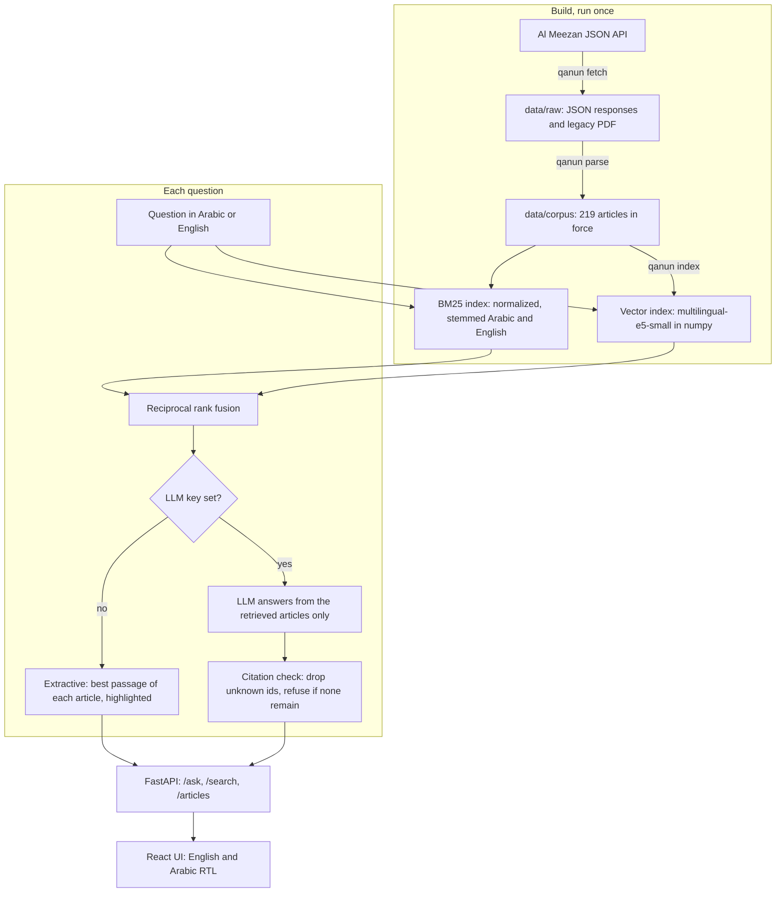

<p align="center">
  
</p>

<p align="center">
  
</p>

**qanun (قانون, "law") is a bilingual question-answering assistant for Qatar's Labour Law that finds the articles behind a question in Arabic or English and cites them exactly.**

<p>
  <a href="LICENSE"></a>
  
  
  <a href="#evaluation"></a>
  <a href="CONTRIBUTING.md"></a>
</p>

> [!WARNING]
> **Not legal advice.** qanun shows what published law texts say. It can retrieve the wrong article, miss a later amendment or leave out context that matters to your case. The Arabic text is the official one; English translations are unofficial. For a real dispute, contact the Ministry of Labour or a qualified lawyer, and check every article on [Al Meezan](https://almeezan.qa) before relying on it.

## Start here

| You are... | Go to |
| --- | --- |
| Working in Qatar with a question about your job | [Try it](#try-it) |
| Building RAG systems | [How it works](#how-it-works) and [Evaluation](#evaluation) |
| Hoping to add another law or more test questions | [Contributing](#contributing) |

## Why

Workers and HR staff in Qatar keep asking the same questions: how much gratuity is owed, how long notice has to be, what the hours are in Ramadan, whether they can move to a new employer. The answers are in the law, but the law is spread across a main statute, amending decrees and ministerial decisions, and it is hard to search. People rarely use its wording: they say "probation" and "sponsor" and "gratuity", and an English speaker may need an article that was only ever published in Arabic.

A legal answer is only useful if you can check it, so qanun treats the citation as the product. Every result points to a specific article, shows its amendment history and links back to the official source.

## What it does

- **Asks in either language.** Answers follow the language of the question, and the web UI switches between English and right-to-left Arabic.
- **Searches three ways.** BM25 with Arabic normalization and light stemming, multilingual embeddings, and a hybrid of the two with reciprocal rank fusion.
- **Works without an API key.** With no LLM configured it returns the best articles with the relevant passage highlighted.
- **Stays grounded with a key.** With an OpenAI or Anthropic key it writes an answer from the retrieved articles only, cites them, and refuses when they do not cover the question. Citations are checked in code after generation: unknown article ids are removed, and an answer left with no valid citation is withheld.
- **Knows the law changes.** Amended articles carry the instrument that changed them and their previous text. Repealed articles are kept out of the search index.

## Try it

You need Python 3.10+ (developed and tested on 3.12) and, for the web UI, Node 20+. The processed corpus ships with the repository, so nothing has to be scraped first.

```bash
git clone <this repository> qanun && cd qanun
python -m venv .venv
source .venv/bin/activate        # Windows: .venv\Scripts\activate

pip install torch --index-url https://download.pytorch.org/whl/cpu
pip install -e ".[embeddings,dev]"

qanun index                      # downloads the embedding model and builds the vector index
qanun ask "How long can a probation period last?"
```

To run the web app, build the UI once and start the server, which serves both on one port:

```bash
cd web && npm ci && npm run build && cd ..
qanun serve                      # http://127.0.0.1:8000, API docs at /docs
```

For UI work, run `npm run dev` in `web/` alongside `qanun serve`; Vite forwards API calls to port 8000.

**With an LLM.** Set a key before starting the server:

```bash
export OPENAI_API_KEY=...                # uses gpt-4o-mini unless QANUN_LLM_MODEL is set
# or
export ANTHROPIC_API_KEY=...
export QANUN_LLM_MODEL=<anthropic model id>
```

**With Docker.** The image builds the UI, bakes in the model and index, and runs as a non-root user. Add `--build-arg EMBEDDING_MODEL=none` for a smaller BM25-only image.

```bash
docker build -t qanun .
docker run -p 8000:8000 -e OPENAI_API_KEY qanun
```

**Tests.** `pytest` runs offline in a few seconds: the embedding model and the LLM are replaced by fakes.

## Screenshots

Real captures of the running app in extractive mode, the only mode that could be run without an API key.

<table>
  <tr>
    <td width="50%"></td>
    <td width="50%"></td>
  </tr>
  <tr>
    <td><b>English answer.</b> Ranked articles with the relevant passage highlighted.</td>
    <td><b>Arabic answer.</b> The whole interface switches to right-to-left.</td>
  </tr>
  <tr>
    <td></td>
    <td></td>
  </tr>
  <tr>
    <td><b>Article view.</b> Official Arabic text next to the unofficial translation.</td>
    <td><b>Search.</b> Compare hybrid, BM25 and embedding rankings on any query.</td>
  </tr>
</table>

## How it works



**Corpus.** Each article becomes one record with its law, chapter, Arabic text, English text where available, amendment history, previous versions and source URL. Articles inserted later, like 52 bis or 115 bis 1, get their own labels. Where Al Meezan lists an old and a new version of an article, the current one is indexed and the old one goes into its history.

**Normalization.** Diacritics and tatweel are removed, and alef forms (أ إ آ), teh marbuta (ة), alef maqsura (ى) and hamza carriers are folded, so `الأجازة` matches `إجازة`. Arabic gets light stemming in the style of light10 and English gets Snowball.

**Retrieval.** BM25 indexes both languages of an article together with its headings. For embeddings, each language is chunked and embedded separately, and an article scores as its best passage. The index is a plain numpy matrix, because an exact dot product over 449 passages is fast and needs no approximate search. Results are fused with RRF at k = 60, the value from the original paper, not tuned on the evaluation set.

**Answering.** Prompts live in [`src/qanun/prompts`](src/qanun/prompts). The model sees the retrieved articles tagged with ids and must cite them in brackets, like `[labour-2004:54]`, or reply `NOT_COVERED`. If the LLM call fails, the API falls back to the extractive result and says so.

## Evaluation

[`eval/questions.jsonl`](eval/questions.jsonl) holds 60 questions (35 English, 25 Arabic) covering gratuity, annual leave, Ramadan hours, probation, notice, minimum wage, changing employers, overtime and more, each labelled with the article or articles that answer it. `qanun eval` reproduces everything below, and the [full report](eval/results.md) lists every question the best-MRR retriever missed.

Recall@k is the share of gold articles in the top k. MRR@10 is the mean reciprocal rank of the first gold article.

| Method | Recall@1 | Recall@3 | Recall@5 | Recall@10 | MRR@10 |
| --- | --- | --- | --- | --- | --- |
| BM25 | 0.375 | 0.583 | 0.617 | 0.750 | 0.503 |
| Embeddings (e5-small) | 0.558 | 0.650 | 0.650 | 0.767 | 0.612 |
| **Hybrid: BM25 + e5-small (default)** | 0.458 | 0.583 | **0.717** | 0.767 | 0.560 |
| Embeddings (MiniLM) | 0.308 | 0.442 | 0.658 | 0.692 | 0.433 |
| Hybrid: BM25 + MiniLM | 0.358 | 0.592 | 0.750 | 0.817 | 0.516 |

By question group, Recall@5:

| Method | English (35) | Arabic (25) | English, answer only in Arabic (9) |
| --- | --- | --- | --- |
| BM25 | 0.543 | 0.720 | 0.111 |
| Embeddings (e5-small) | 0.600 | 0.720 | 0.000 |
| Hybrid: BM25 + e5-small (default) | 0.657 | 0.800 | 0.000 |
| Embeddings (MiniLM) | 0.657 | 0.660 | 0.444 |
| Hybrid: BM25 + MiniLM | 0.686 | 0.840 | 0.222 |

What the numbers say:

- **Fusion is a trade-off here, not a free win.** Hybrid search finds more gold articles in the top 5, but e5-small alone is better at ranking the right article first. Plain RRF lets a weak BM25 ranking pull a good dense result down.
- **The retrieval is not good enough yet to trust blindly.** `/ask` returns 4 articles by default, and Recall@4 for the default setup is 0.667, so about one question in three does not get the right article.
- **Cross-lingual retrieval is the weakest part.** On the 9 English questions whose answer exists only in Arabic, the default setup puts none in the top 5. MiniLM alone finds 4 of 9, but it is the weaker model everywhere else.
- **The numbers are a small, honest sample.** With 60 questions, one question moves Recall by about 0.017, so the gap between the two hybrids (2 questions) is within noise. The questions and labels were written by one author, most questions have a single gold article, and comparing models on this set is how e5-small was chosen as the default, so treat these as development numbers rather than a held-out score.

Some example questions, with the rank of the gold article (a dash means not in the top 10):

| Question | Gold article | BM25 | e5-small | Hybrid | What happened |
| --- | --- | --- | --- | --- | --- |
| What are the working hours during Ramadan? | Labour Law 73 | 2 | 1 | 2 | Article 90, on the hours of minors, also mentions Ramadan and ranks first in the hybrid list |
| ما هي أقصى مدة لفترة التجربة في عقد العمل؟ | Labour Law 39 | 3 | 1 | 2 | The law says `الاختبار` where people say `التجربة`; embeddings bridge the gap |
| Can I change employers without a no objection certificate from my current employer? | Residency Law 21 | 2 | - | 5 | Fusion rescues a keyword match the embeddings missed |
| How much notice do I have to give before resigning if I have worked for three years? | Labour Law 49 | - | - | - | Article 49 was rewritten in 2020 and has no English text, so nothing connects the question to it |
| هل يحق لي الانتقال إلى صاحب عمل آخر دون موافقة الكفيل؟ | Residency Law 21 | - | - | - | A very short article; the neighbouring Article 23 ranks first |

The LLM path has unit tests with mocked HTTP responses. No API key was available during development, so **answer quality has not been measured** and no generated answer appears in this README.

## API

| Endpoint | Purpose |
| --- | --- |
| `POST /ask` | Body: `question`, optional `k` (1-10), `mode` (`auto`, `extractive`, `generative`), `laws`. Returns the answer, language, mode and citations with highlighted passages. |
| `GET /search?q=&k=&method=&law=` | Ranked articles. `method` is `bm25`, `dense` or `hybrid`. |
| `GET /articles/{label}?law=` | One article, with amendments and history. Labels look like `54`, `52-bis`, `115-bis-1`, `issuance-2`. `law` defaults to `labour-2004`. |
| `GET /articles?law=` | All articles of a law. |
| `GET /laws`, `GET /health` | The laws in the corpus, and what the server has enabled. |

```bash
curl -X POST http://127.0.0.1:8000/ask \
  -H "Content-Type: application/json" \
  -d '{"question": "How long can a probation period last?", "k": 3}'
```

### Settings

| Variable | Meaning |
| --- | --- |
| `QANUN_EMBEDDING_MODEL` | `e5-small` (default), `minilm`, any sentence-transformers id, or `none` for BM25 only |
| `OPENAI_API_KEY`, `OPENAI_BASE_URL` | OpenAI, or any compatible server |
| `ANTHROPIC_API_KEY`, `ANTHROPIC_BASE_URL` | Anthropic |
| `QANUN_LLM_PROVIDER` | `openai`, `anthropic` or `none`; picked from the key that is set when omitted |
| `QANUN_LLM_MODEL` | Model name. Optional for OpenAI, required for Anthropic |
| `QANUN_LLM_TIMEOUT`, `QANUN_LLM_MAX_TOKENS` | Defaults: 60 seconds, 800 tokens |
| `QANUN_CORS_ORIGINS` | Comma-separated origins, if the UI is hosted elsewhere |
| `QANUN_ROOT`, `QANUN_DATA_DIR`, `QANUN_INDEX_DIR`, `QANUN_STATIC_DIR` | Override file locations |

## Project layout

```text
src/qanun/
  corpus/      download, parse and store the legislation
  text/        Arabic and English normalization, tokenizer, stemmers
  retrieval/   BM25, embeddings, rank fusion
  answer/      passage highlighting, LLM clients, grounded generation
  prompts/     prompt templates
  api/         FastAPI service
  evaluation.py, search.py, cli.py
web/           React + Vite UI
eval/          questions, results.json, results.md
data/corpus/   processed articles (data/raw and data/index are rebuilt, not committed)
tests/         pytest suite
```

## Data sources and terms

| Source | Used for | Notes |
| --- | --- | --- |
| [Al Meezan](https://almeezan.qa), legal portal of Qatar's Ministry of Justice | All Arabic text, English where available, amendment history | Read through the JSON API that the portal's own web app calls. It is public but undocumented, so it may change without notice. |
| Al Meezan English export of the Labour Law, [mirrored by AUC's Center for Migration and Refugee Studies](https://www4.aucegypt.edu/CMRS/Files/Law_14_2004_3961%20(1).pdf) | English text of 73 Labour Law articles in force | Reflects amendments up to 2009. Used only for articles whose text has not changed since. |

| Law | Articles in force | With English |
| --- | --- | --- |
| Labour Law, Law No. 14 of 2004, as amended | 163 | 146 |
| Minimum Wage Law, Law No. 17 of 2020 | 8 | 0 |
| Ministerial Decision No. 25 of 2020 on minimum wage amounts | 5 | 0 |
| Expatriates Entry, Exit and Residency Law, Law No. 21 of 2015, as amended | 43 | 43 |

The 2020 job-change reforms are covered through the amended Labour Law and Article 21 of the Residency Law. The downloader sends one request at a time with a pause between requests, identifies itself in its User-Agent, and caches every response. At download time `almeezan.qa/robots.txt` allowed all paths.

**Terms.** The law texts belong to their publishers and are not covered by this repository's MIT license. Al Meezan links its terms of use from the portal, but they could not be read through the API, so read them yourself before reusing the data. The older export states that it should not be considered official, and the Arabic text is the authoritative one.

**Known gaps in the data:**

- The portal returned 44 of the 50 articles of Law 21 of 2015. Article 1 and Articles 46 to 50 are missing from the corpus.
- 17 Labour Law articles have no English text, including Articles 49, 51 and 66 as rewritten or amended since 2009. None of the minimum wage texts have English on the portal.
- The older translation differs from the Arabic in places. Three differences found during review are flagged on the articles themselves (Articles 61, 74 and 78); for example, it gives the night-work window as 9 pm to 6 am where the Arabic says 9 pm to 3 am. Not every article was compared by hand, so more may exist.
- Article 52 bis contains a stray `?` inside a word in the source text. It is kept as published.
- The corpus is a snapshot from October 2026. Run `qanun fetch --refresh` and `qanun parse` to update it.

## Roadmap

- [x] Bilingual corpus with amendment history
- [x] Hybrid retrieval with a measured evaluation
- [x] Extractive and LLM answer modes with checked citations
- [ ] Better retrieval for English questions on Arabic-only articles, for example query translation or a reranker
- [ ] Measure LLM answer quality: faithfulness, citation accuracy, refusal rate
- [ ] A held-out question set, reviewed by a labour lawyer
- [ ] More laws: domestic workers (Law No. 15 of 2017), the Workers' Support and Insurance Fund, and ministerial decisions on rest and heat
- [ ] WhatsApp bot, since that is where many workers already ask these questions
- [ ] More languages for the question side, such as Hindi, Urdu, Nepali and Bengali
- [ ] A scheduled check that flags articles changed on Al Meezan

## FAQ

**Can I rely on an answer for my own case?**
No. Use qanun to find the relevant article, then read that article and get proper advice. See the warning at the top.

**Why did my English question return Arabic text?**
Some articles have no English translation, including important ones changed in 2020. qanun shows the official Arabic rather than inventing a translation.

**Do I need an API key?**
No. Search, highlighting, the API and the UI all work without one. You only need a key for written answers.

**Where do my questions go?**
qanun has no database and does not store questions, though server access logs record `/search` URLs including the query. In LLM mode, the question and the retrieved articles are sent to the provider you configured.

**Why numpy instead of FAISS?**
The index has 449 vectors. An exact search is simple, fast enough and has no extra dependency. An approximate index would be worth adding for a much larger corpus.

**Why is the default not the model with the best Recall@5?**
The two hybrids differ by 2 questions out of 60, which is noise, while e5-small is clearly better at ranking the right article first.

**Does the Docker image work?**
The Dockerfile has not been built yet, because Docker was not available on the development machine. Its web build steps and a non-editable package install were tested separately. Please open an issue if it fails.

## Contributing

Contributions are welcome, especially new laws, better test questions and corrections to the data. [CONTRIBUTING.md](CONTRIBUTING.md) explains how to add a law or evaluation questions and how to report a wrong answer.

## License

The code is under the [MIT license](LICENSE), Copyright (c) 2026 Mohaned Elhagar. The law texts belong to their publishers and are not covered by that license.
