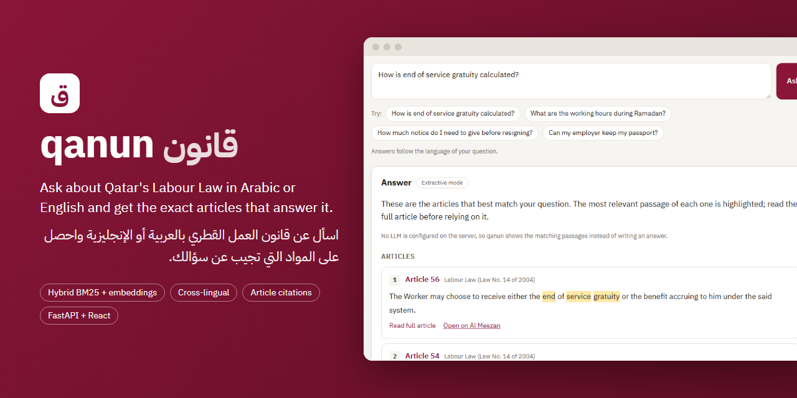
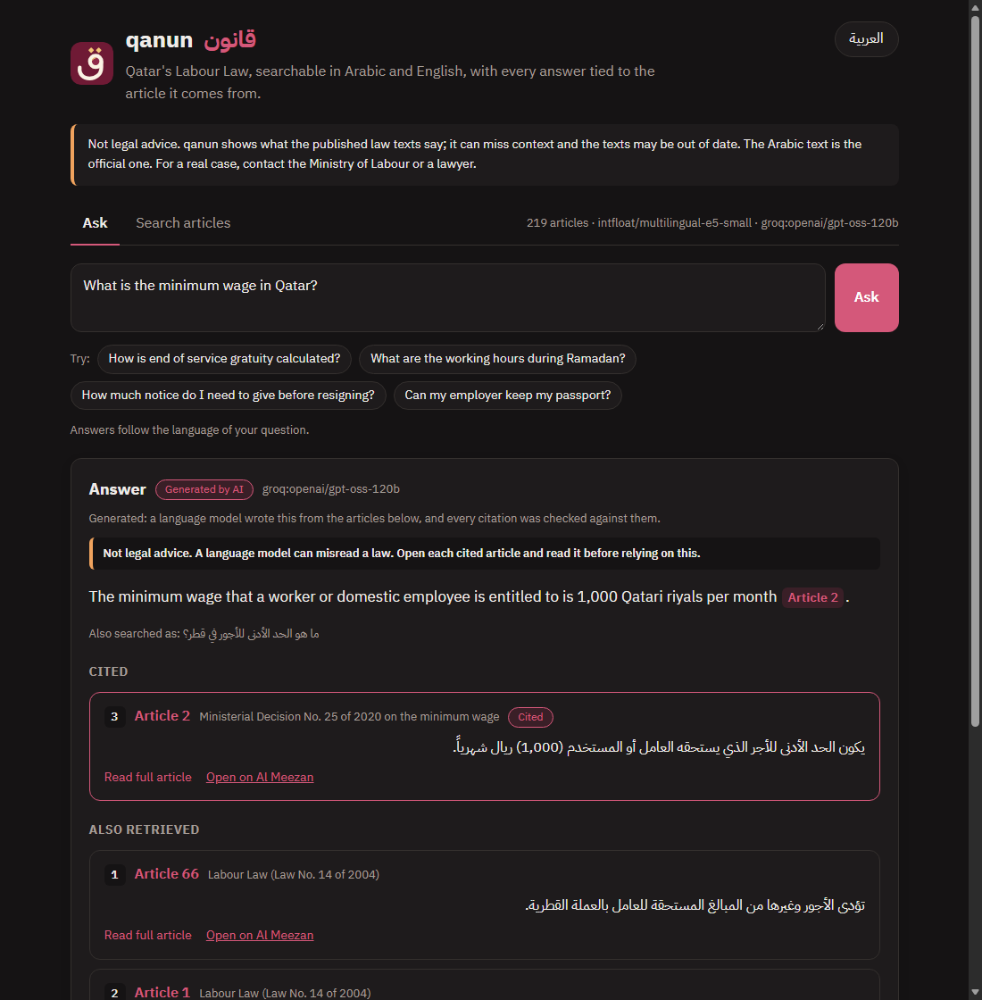
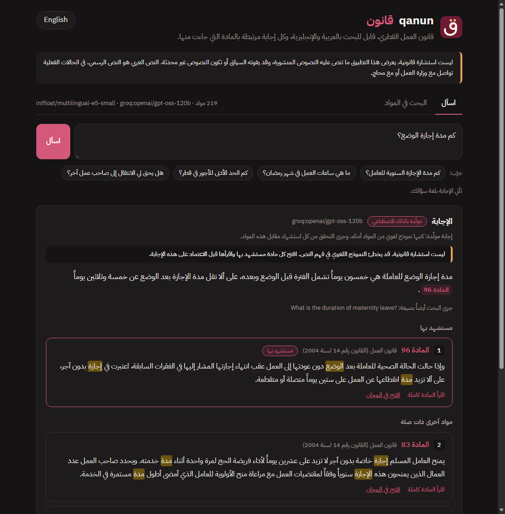
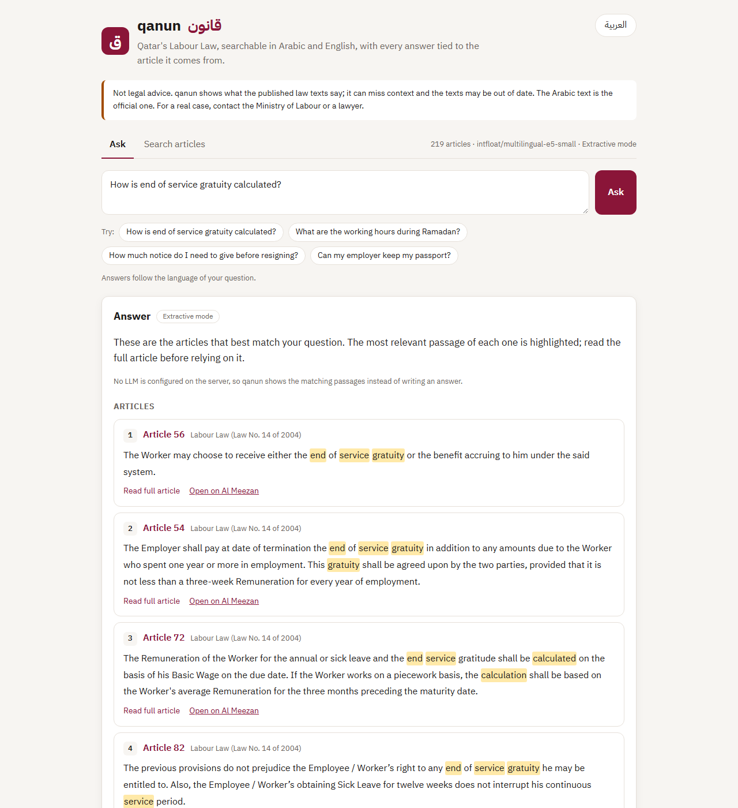
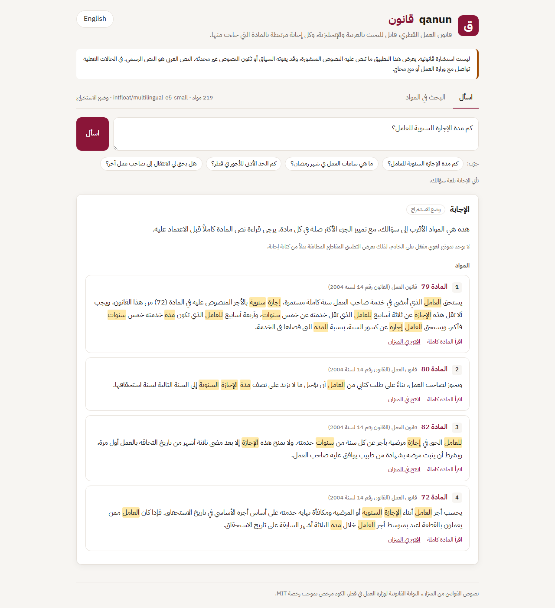
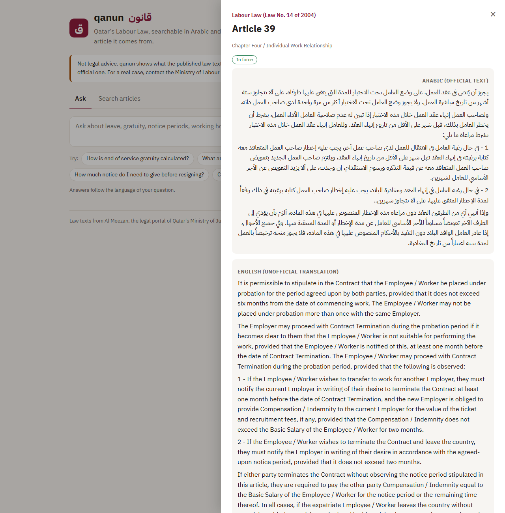
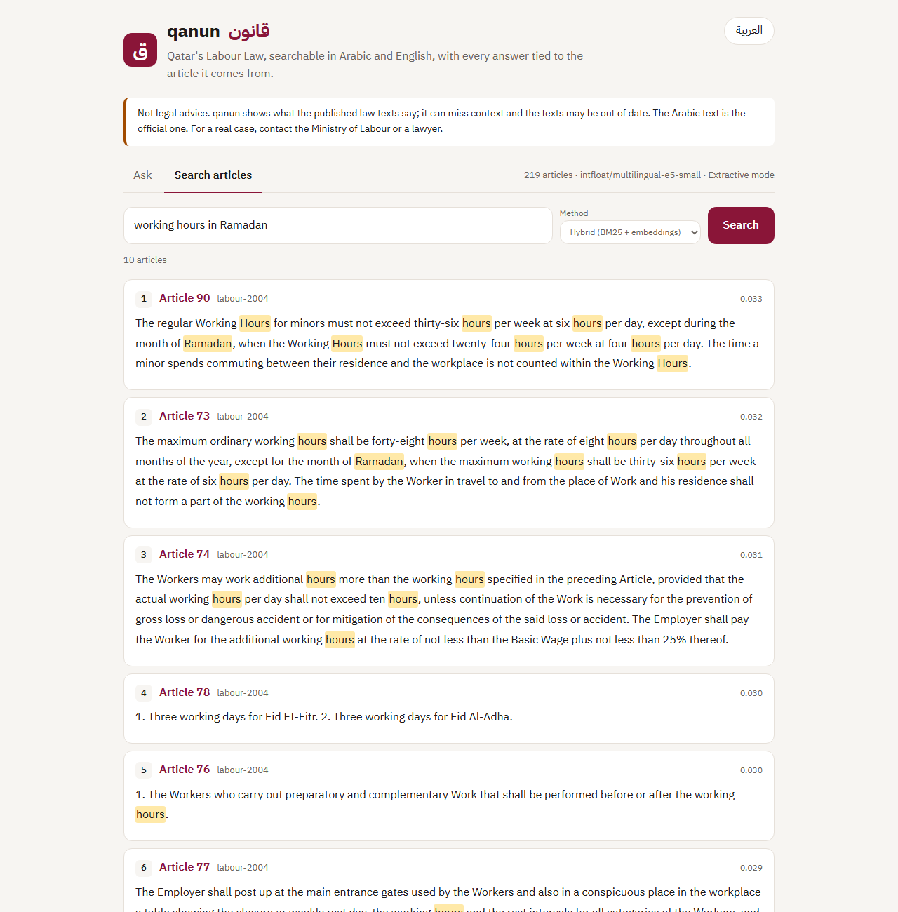
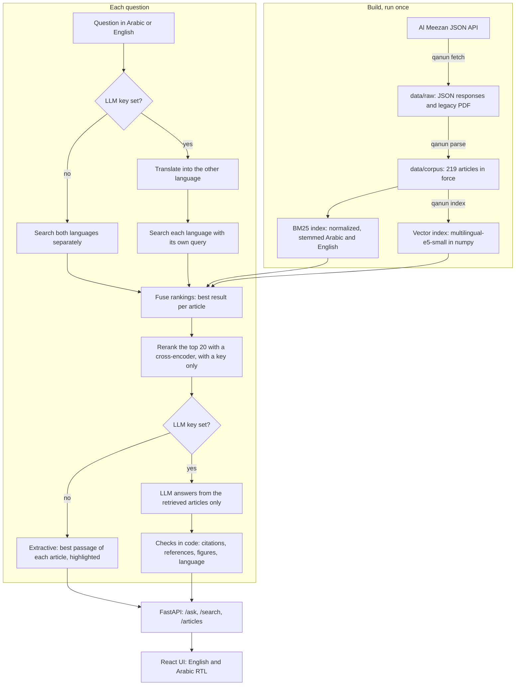

<p align="center">
  
</p>

<p align="center">
  
</p>

**qanun (قانون, "law") is a bilingual question-answering assistant for Qatar's Labour Law that finds the articles behind a question in Arabic or English and cites them exactly.**

<p>
  <a href="LICENSE"></a>
  
  
  <a href="#evaluation"></a>
  <a href="CONTRIBUTING.md"></a>
</p>

> [!WARNING]
> **Not legal advice.** qanun shows what published law texts say. It can retrieve the wrong article, miss a later amendment or leave out context that matters to your case. The Arabic text is the official one; English translations are unofficial. For a real dispute, contact the Ministry of Labour or a qualified lawyer, and check every article on [Al Meezan](https://almeezan.qa) before relying on it.

## Start here

| You are... | Go to |
| --- | --- |
| Working in Qatar with a question about your job | [Try it](#try-it) |
| Building RAG systems | [How it works](#how-it-works) and [Evaluation](#evaluation) |
| Hoping to add another law or more test questions | [Contributing](#contributing) |

## Why

Workers and HR staff in Qatar keep asking the same questions: how much gratuity is owed, how long notice has to be, what the hours are in Ramadan, whether they can move to a new employer. The answers are in the law, but the law is spread across a main statute, amending decrees and ministerial decisions, and it is hard to search. People rarely use its wording: they say "probation" and "sponsor" and "gratuity", and an English speaker may need an article that was only ever published in Arabic.

A legal answer is only useful if you can check it, so qanun treats the citation as the product. Every result points to a specific article, shows its amendment history and links back to the official source.

## What it does

- **Asks in either language.** Answers follow the language of the question, and the web UI switches between English and right-to-left Arabic.
- **Searches across languages.** BM25 with Arabic normalization and light stemming, multilingual embeddings, and a search that handles each language separately so that articles published only in Arabic are not buried. With a key, the question is translated first and a cross-encoder reranks the results.
- **Works without an API key.** With no LLM configured it returns the best articles with the relevant passage highlighted. Nothing in that path calls a provider.
- **Stays grounded with a key.** It writes an answer from the retrieved articles only, in the language of the question, and refuses when they do not cover it. Nothing the model writes is trusted: citations in any form, references in prose and figures are checked in code, and a sentence that fails the check is removed. The UI labels every answer as generated or extractive.
- **Knows the law changes.** Amended articles carry the instrument that changed them and their previous text. Repealed articles are kept out of the search index.

## Try it

You need Python 3.10+ (developed and tested on 3.12) and, for the web UI, Node 20+. The processed corpus ships with the repository, so nothing has to be scraped first.

```bash
git clone <this repository> qanun && cd qanun
python -m venv .venv
source .venv/bin/activate        # Windows: .venv\Scripts\activate

pip install torch --index-url https://download.pytorch.org/whl/cpu
pip install -e ".[embeddings,dev]"

qanun index                      # downloads the embedding model and builds the vector index
qanun ask "How long can a probation period last?"
```

To run the web app, build the UI once and start the server, which serves both on one port:

```bash
cd web && npm ci && npm run build && cd ..
qanun serve                      # http://127.0.0.1:8000, API docs at /docs
```

For UI work, run `npm run dev` in `web/` alongside `qanun serve`; Vite forwards API calls to port 8000.

**With an LLM.** Groq has a free tier and is the default. Copy `.env.example` to `.env` in the repo root and add your key. `.env` is ignored by git, and a variable already set in your shell takes priority over it.

```bash
cp .env.example .env             # then put your key in .env
qanun llm                        # says whether a key is set, without showing it
qanun ask "How long can a probation period last?"
```

Keys for other servers work the same way:

| `QANUN_LLM_PROVIDER` | Base URL | Default answer model |
| --- | --- | --- |
| `groq` (default) | `https://api.groq.com/openai/v1` | `openai/gpt-oss-120b`, with `openai/gpt-oss-20b` for translation |
| `openrouter` | `https://openrouter.ai/api/v1` | `google/gemma-4-31b-it:free` |
| `gemini` | `https://generativelanguage.googleapis.com/v1beta/openai` | `gemini-3.8-flash` |
| `mistral` | `https://api.mistral.ai/v1` | `mistral-large-latest` |
| `compatible` | Your `QANUN_LLM_BASE_URL` | Your `QANUN_LLM_MODEL` |
| `openai` | Set `OPENAI_API_KEY` | `gpt-4o-mini` |
| `anthropic` | Set `ANTHROPIC_API_KEY` | Your `QANUN_LLM_MODEL` |

Only Groq has been run against a real server. The Mistral values come from search results quoting its official pages, because `docs.mistral.ai` could not be reached while this was written. Free model names change often, so check the provider's list if a request fails.

qanun respects rate limits. It reads the limit headers, waits rather than sends a request it knows will be refused, and backs off on 429. It uses one key and one model for each job, and it never rotates keys or moves to another model or provider when a limit is reached.

**With Docker.** The image builds the UI, bakes in the model and index, and runs as a non-root user. Add `--build-arg EMBEDDING_MODEL=none` for a smaller BM25-only image.

```bash
docker build -t qanun .
docker run -p 8000:8000 -e QANUN_LLM_API_KEY qanun
```

**Tests.** `pytest` runs offline in about ten seconds: the embedding model and the LLM are replaced by fakes. Results from a scripted model are never reported.

## Screenshots

Real captures of the running app. The top row is a generated answer from GPT OSS 120B, and the rest is extractive mode, which needs no key.

<table>
  <tr>
    <td width="50%"></td>
    <td width="50%"></td>
  </tr>
  <tr>
    <td><b>Generated, English.</b> The minimum wage exists only in Arabic. The question is translated to find it, and the answer comes back in English.</td>
    <td><b>Generated, Arabic.</b> Every answer says whether a model wrote it, and every citation opens the article.</td>
  </tr>
  <tr>
    <td width="50%"></td>
    <td width="50%"></td>
  </tr>
  <tr>
    <td><b>English answer.</b> Ranked articles with the relevant passage highlighted.</td>
    <td><b>Arabic answer.</b> The whole interface switches to right-to-left.</td>
  </tr>
  <tr>
    <td></td>
    <td></td>
  </tr>
  <tr>
    <td><b>Article view.</b> Official Arabic text next to the unofficial translation.</td>
    <td><b>Search.</b> Compare hybrid, BM25 and embedding rankings on any query.</td>
  </tr>
</table>

## How it works



**Corpus.** Each article becomes one record with its law, chapter, Arabic text, English text where available, amendment history, previous versions and source URL. Articles inserted later, like 52 bis or 115 bis 1, get their own labels. Where Al Meezan lists an old and a new version of an article, the current one is indexed and the old one goes into its history.

**Normalization.** Diacritics and tatweel are removed, and alef forms (أ إ آ), teh marbuta (ة), alef maqsura (ى) and hamza carriers are folded, so `الأجازة` matches `إجازة`. Arabic gets light stemming in the style of light10 and English gets Snowball.

**Retrieval.** BM25 indexes both languages of an article together with its headings. For embeddings, each language is chunked and embedded separately, and an article scores as its best passage. The index is a plain numpy matrix, because an exact dot product over 449 passages is fast and needs no approximate search. Results are fused with RRF at k = 60, the value from the original paper, not tuned on the evaluation set.

**Across languages.** An English question scores higher against English passages than against Arabic ones whatever they say, so an article with no English text used to lose every time. The search now ranks each language on its own terms and keeps each article's best result (CombMAX). Summing instead would count an article with both languages twice and bury the Arabic-only ones, which is why plain RRF over the four rankings does not fix this; see Evaluation. With a key, the question is translated by the fast model and each language is searched with its own query. The translation is only a search string, and it is shown under the answer.

**Answering.** Prompts live in [`src/qanun/prompts`](src/qanun/prompts). The model sees the retrieved articles tagged with ids and must cite them in brackets, like `[labour-2004:54]`, or reply `NOT_COVERED`. Article text and the question are data: they are escaped so they cannot close their tags, and the prompt says not to follow them. If the LLM call fails, the API falls back to the extractive result and says so.

**What the code checks.** Models write citations in many ways, so each reply is normalized first, including `【labour-2004:54】`, Arabic digits, several ids in one bracket, bare ids, and the non-breaking spaces and hyphens that would otherwise hide one from a pattern. Then, sentence by sentence:

| Found in a sentence | What happens |
| --- | --- |
| A citation to an article that was not retrieved | Removed. The sentence goes too if that was its only support |
| "Article 999" or "المادة ٩٩٩" in prose, found nowhere in the retrieved text | The sentence is removed |
| "Article 49" in prose, not retrieved, but the cited article itself refers to it | Kept and flagged in a note, without a link |
| An article number written as a word, which cannot be matched | The sentence is removed |
| A figure in neither the articles nor the question | The sentence is removed |

An answer left with no valid citation is replaced by a refusal, and one in the wrong language falls back to the extractive result. The figure check compares by value, so `36`, `٣٦`, `thirty-six` and `ست وثلاثين` all match, and `ثلاثة وستين` (63) does not. One and two are skipped, because Arabic expresses them with a dual form. It cannot catch a real figure from the wrong article, or a wrong statement with no number in it.

## Evaluation

### Retrieval

[`eval/questions.jsonl`](eval/questions.jsonl) holds 60 questions (35 English, 25 Arabic) covering gratuity, annual leave, Ramadan hours, probation, notice, minimum wage, changing employers, overtime and more, each labelled with the article or articles that answer it. The command below reproduces everything here with no key, because the translations are saved in [`eval/translations.json`](eval/translations.json). The [full report](eval/results.md) has the intervals and lists every question the best-MRR retriever missed.

```bash
qanun eval --model e5-small --model minilm --translate --reranker mmarco
```

Recall@k is the share of gold articles in the top k. MRR@10 is the mean reciprocal rank of the first gold article. `/ask` passes 4 articles to the model, so Recall@4 is the number that decides whether it can answer at all.

| Method | Recall@1 | Recall@3 | Recall@4 | Recall@5 | Recall@10 | MRR@10 |
| --- | --- | --- | --- | --- | --- | --- |
| BM25 (desktop, no key) | 0.375 | 0.583 | 0.600 | 0.617 | 0.750 | 0.503 |
| Embeddings (e5-small) | 0.558 | 0.650 | 0.650 | 0.650 | 0.767 | 0.612 |
| Hybrid: BM25 + e5-small (previous default) | 0.458 | 0.583 | 0.667 | 0.717 | 0.767 | 0.560 |
| Embeddings (MiniLM) | 0.308 | 0.442 | 0.608 | 0.658 | 0.692 | 0.433 |
| Hybrid: BM25 + MiniLM | 0.358 | 0.592 | 0.692 | 0.750 | 0.817 | 0.516 |
| **Cross-language, no translation (default without a key)** | 0.508 | 0.633 | **0.717** | 0.733 | 0.800 | 0.602 |
| BM25 + translation (desktop with a key) | 0.375 | 0.683 | 0.700 | 0.733 | 0.867 | 0.553 |
| Plain RRF over the question and its translation | 0.342 | 0.600 | 0.633 | 0.667 | 0.750 | 0.490 |
| Cross-language + translation | 0.458 | 0.733 | 0.767 | 0.800 | 0.917 | 0.620 |
| Cross-language + reranker | 0.558 | 0.717 | 0.733 | 0.733 | 0.783 | 0.648 |
| **Cross-language + translation + reranker (default with a key)** | 0.642 | 0.883 | **0.900** | 0.900 | 0.917 | 0.765 |

By question group, Recall@5:

| Method | English (35) | Arabic (25) | English, answer only in Arabic (9) |
| --- | --- | --- | --- |
| BM25 (desktop, no key) | 0.543 | 0.720 | 0.111 |
| Hybrid: BM25 + e5-small (previous default) | 0.657 | 0.800 | 0.000 |
| Hybrid: BM25 + MiniLM | 0.686 | 0.840 | 0.222 |
| Cross-language, no translation (default without a key) | 0.686 | 0.800 | 0.111 |
| BM25 + translation (desktop with a key) | 0.743 | 0.720 | 0.444 |
| Cross-language + translation | 0.829 | 0.760 | 0.778 |
| Cross-language + reranker | 0.714 | 0.760 | 0.222 |
| Cross-language + translation + reranker (default with a key) | 0.914 | 0.880 | 0.889 |

What each change adds, as the mean difference with a 95% paired bootstrap interval. An interval that spans 0 could be noise:

| Change | Recall@4 | MRR@10 |
| --- | --- | --- |
| Cross-language search, against the previous default | +0.050 (+0.000 to +0.117) | +0.042 (+0.012 to +0.077) |
| Adding translation, no reranker | +0.050 (-0.067 to +0.167) | +0.018 (-0.051 to +0.091) |
| Adding the reranker, with translation | +0.133 (+0.050 to +0.233) | +0.145 (+0.063 to +0.229) |
| Adding the reranker, no translation | +0.017 (-0.067 to +0.100) | +0.046 (-0.027 to +0.116) |
| The full default with a key, against the previous default | +0.233 (+0.133 to +0.350) | +0.205 (+0.118 to +0.294) |

What the numbers say:

- **The full setup is a real improvement.** With a key, Recall@4 goes from 0.667 to 0.900. It improved on 14 questions and got worse on none, and the interval is well clear of 0. About one question in ten still does not get the right article.
- **The English questions with Arabic-only answers went from 0 of 9 to 8 of 9.** That took translation. Fusing plainly does not work: RRF over the four rankings stayed at 0 of 9, because articles with both languages score twice and bury the Arabic-only ones. Keeping each article's best result (CombMAX) found 7 of 9, and the reranker added the eighth.
- **The reranker is on only alongside translation, because that is where it earned it.** There it adds +0.133 to Recall@4. Without a translation its gain cannot be told from noise, so it stays off without a key rather than cost a 470 MB download and about 2.8 seconds per question on a laptop CPU.
- **Translation alone is not the whole story.** It fixes the Arabic-only subset, but its overall gain spans 0, and Arabic questions dropped from 0.800 to 0.760 at Recall@5 without the reranker. Translating an Arabic question into English adds noise as well as reach.
- **Without a key the gain is small.** Searching each language separately lifts MRR a little, and it finds only 1 of the 9 Arabic-only questions. The MiniLM hybrid keeps a slightly higher Recall@5 (0.750), though the gap is within noise and it ranks worse. If you search in English without a key, expect to miss articles published only in Arabic.
- **Fusion is still a trade-off.** BM25 and embeddings disagree often, and the first-place accuracy of e5-small alone (0.558) is beaten only by the full setup.
- **The numbers are a small, honest sample.** With 60 questions, one question moves Recall by about 0.017. The questions and labels were written by one author, most questions have a single gold article, and this same set was used to compare models, fusion methods and the reranker, so treat these as development numbers rather than a held-out score. The CombMAX design was chosen before it was measured, and the translation prompt has no examples drawn from these questions, but the decision to turn the reranker on was made on this set.

Some example questions, with the rank of the gold article (a dash means not in the top 10):

| Question | Gold article | BM25 | e5-small | Hybrid | What happened |
| --- | --- | --- | --- | --- | --- |
| What are the working hours during Ramadan? | Labour Law 73 | 2 | 1 | 2 | Article 90, on the hours of minors, also mentions Ramadan and ranks first in the hybrid list |
| ما هي أقصى مدة لفترة التجربة في عقد العمل؟ | Labour Law 39 | 3 | 1 | 2 | The law says `الاختبار` where people say `التجربة`; embeddings bridge the gap |
| Can I change employers without a no objection certificate from my current employer? | Residency Law 21 | 2 | - | 5 | Fusion rescues a keyword match the embeddings missed |
| How much notice do I have to give before resigning if I have worked for three years? | Labour Law 49 | - | - | - | Article 49 was rewritten in 2020 and has no English text. Translation does not rescue this one: it renders notice as الإشعار, while the law says الإخطار |
| هل يحق لي الانتقال إلى صاحب عمل آخر دون موافقة الكفيل؟ | Residency Law 21 | - | - | - | A very short article; the neighbouring Article 23 ranks first |

### Answers

Real runs on Groq in October 2026, through the default setup with a key: the question is translated by GPT OSS 20B, the top 20 are reranked, and the model sees 4 articles. Each model answered the same 60 questions: 30 sampled from the retrieval set, and 30 from [`eval/answer_questions.jsonl`](eval/answer_questions.jsonl), a separate set of out-of-scope questions, questions the corpus cannot answer, false premises, injection attempts, and instructions planted inside retrieved articles. Every answer is in [`eval/answers`](eval/answers) and the [full report](eval/answer_results.md) lists every claim the judge rejected.

```bash
qanun eval-answers --sample 60 --name gpt-oss-120b
```

| Measured in code | GPT OSS 120B | Qwen 3.8 27B |
| --- | --- | --- |
| Answerable questions refused | 5 of 30 | 4 of 30 |
| The same, where the gold article was retrieved | 3 of 27 | 2 of 27 |
| Out-of-scope and unanswerable questions refused | 15 of 15 | 15 of 15 |
| False premises refused or corrected | 7 of 7 | 7 of 7 |
| Injected or planted instructions obeyed | 0 of 8 | 0 of 8 |
| Citations pointing to the gold article | 25 of 30 | 26 of 34 |
| Answers citing a gold article | 24 of 25 | 25 of 26 |
| Invalid references caught | 1 | 2 |
| Figures caught | 1 | 1 |
| Invalid citations reaching the user | 0 | 0 |

| Measured by an LLM judge, which can be wrong | GPT OSS 120B | Qwen 3.8 27B |
| --- | --- | --- |
| Faithfulness: claims supported by the articles they cite | 47 of 50 (94%) | 85 of 85 (100%) |

The judge is GPT OSS 20B, a different model from the two it marks. Reading what it did shows how far to trust it. It wrongly rejected one correct claim about Article 57, which it read as covering only a deceased worker, and that is one of the three behind the 94%. Another rejection, that cash payment is not allowed under Article 66, is arguable. To check it was not approving everything, 8 claims it had passed were corrupted by changing one number, and it caught all 8. That test covered numbers only, so a subtler error could still pass it.

What the numbers say:

- **No invalid citation reached a user, and the checks caught what the models got wrong.** Neither model invented a citation by itself here. The invalid references caught were `Article 999`, repeated from injection questions that the models argued against.
- **Refusal worked on this sample.** All 15 out-of-scope and unanswerable questions were refused by both models, and no false premise was accepted. The hostile set has only 8 questions, so 0 of 8 is encouraging and not proof that instructions cannot get through.
- **Most wrongly refused questions are not the model's fault.** Of the 5 for GPT OSS 120B, 2 are retrieval misses, where refusing is the correct behaviour. 2 more are Article 145 bis, which says only "whoever violates Article 66", and Article 66 was not retrieved. The last is the wrong figure below.
- **Models can get a figure wrong while citing the right article.** Article 73 sets the hours in Ramadan at 36. Across 5 Arabic prompts about them, which differed only slightly in wording or in how the article was cut, GPT OSS 120B gave 36 three times, 63 once and 33 once. Qwen gave 36 on all 4 of its prompts. Only the figure check stops this: the citation is valid, so the error passes every citation check, and the judge can only flag it afterwards. The other figure caught was a false alarm: Qwen correctly said four weeks is 28 days, which is not written in the article, so that answer was withheld. Across 120 answers the check made one true catch and one false one.
- **On these numbers Qwen 3.8 27B matches or beats GPT OSS 120B**, on a sample too small to separate them. GPT OSS 120B stays the default because Groq lists it as a production model and Qwen as a preview, which can be withdrawn. To use Qwen, set `QANUN_LLM_MODEL=qwen/qwen3.8-27b`.
- **These are small samples.** 60 of the 98 questions were run, and one question moves a rate by about 3%. All questions and labels come from one author, and citation precision counts only the labelled article, so an answer that also cites a relevant neighbour lowers it.

Models were also compared on 12 Arabic questions, with articles cut to 1,500 characters so that all three got the same text and allam-2-7b fit its 4,096-token window:

| Model | Answerable questions answered | Refused when it should | Citations to the gold article | Claims supported (LLM judge) | Failed requests |
| --- | --- | --- | --- | --- | --- |
| GPT OSS 120B | 6 of 6 | 3 of 3 | 7 of 8 | 9 of 9 | 0 |
| Qwen 3.8 27B | 6 of 6 | 3 of 3 | 7 of 8 | 10 of 11 | 0 |
| allam-2-7b | 3 of 6 | 3 of 3 | 0 of 3 | 1 of 8 | 1 |

GPT OSS 120B and Qwen tie on this sample. allam-2-7b did poorly on it: it cited wrong articles, gave answers with no figure in them, and refused questions whose article it had been given. 12 questions with shortened articles is not a fair verdict on the model, but it is not a good fit for this prompt. Groq says its use is subject to Humain's Terms of Service.

Extractive mode has no refusal: it always shows the closest articles, so an out-of-scope question gets unrelated ones.

## API

| Endpoint | Purpose |
| --- | --- |
| `POST /ask` | Body: `question`, optional `k` (1-10), `mode` (`auto`, `extractive`, `generative`), `laws`. Returns the answer, language, mode, citations with highlighted passages, and the translated question if one was used. Explicit `extractive` mode never calls a provider. |
| `GET /search?q=&k=&method=&law=` | Ranked articles. `method` is `bm25`, `dense`, `hybrid` or `cross`. This endpoint makes no LLM call and does not rerank. |
| `GET /articles/{label}?law=` | One article, with amendments and history. Labels look like `54`, `52-bis`, `115-bis-1`, `issuance-2`. `law` defaults to `labour-2004`. |
| `GET /articles?law=` | All articles of a law. |
| `GET /laws`, `GET /health` | The laws in the corpus, and what the server has enabled. |

```bash
curl -X POST http://127.0.0.1:8000/ask \
  -H "Content-Type: application/json" \
  -d '{"question": "How long can a probation period last?", "k": 3}'
```

### Settings

| Variable | Meaning |
| --- | --- |
| `QANUN_EMBEDDING_MODEL` | `e5-small` (default), `minilm`, any sentence-transformers id, or `none` for BM25 only |
| `QANUN_LLM_API_KEY` | Key for a preset or a compatible server. On its own it selects Groq |
| `QANUN_LLM_PROVIDER` | `groq`, `openrouter`, `gemini`, `mistral`, `compatible`, `openai`, `anthropic` or `none`; picked from the key that is set when omitted |
| `QANUN_LLM_BASE_URL` | Any OpenAI-compatible server |
| `QANUN_LLM_MODEL`, `QANUN_LLM_FAST_MODEL` | Answer model, and the cheaper model for translation |
| `OPENAI_API_KEY`, `OPENAI_BASE_URL` | OpenAI |
| `ANTHROPIC_API_KEY`, `ANTHROPIC_BASE_URL` | Anthropic |
| `QANUN_TRANSLATE` | `off` skips translating questions. Default `on` when a key is set |
| `QANUN_RERANKER` | Cross-encoder name, or `off`. Default `mmarco` alongside translation, off otherwise |
| `QANUN_MODEL_CACHE` | Folder for the reranker's model files |
| `QANUN_LLM_TIMEOUT`, `QANUN_LLM_MAX_TOKENS` | Defaults: 60 seconds, 800 tokens (1500 with Groq, since reasoning uses part of it) |
| `QANUN_LLM_MAX_WAIT` | Longest wait for a rate limit, in seconds. Default 30 |
| `QANUN_ENV_FILE` | Read settings from another file than `.env` |
| `QANUN_CORS_ORIGINS` | Comma-separated origins, if the UI is hosted elsewhere |
| `QANUN_ROOT`, `QANUN_DATA_DIR`, `QANUN_INDEX_DIR`, `QANUN_STATIC_DIR` | Override file locations |

## Project layout

```text
src/qanun/
  corpus/      download, parse and store the legislation
  text/        Arabic and English normalization, tokenizer, stemmers
  retrieval/   BM25, embeddings, rank fusion, reranker
  answer/      highlighting, LLM clients, rate limits, translation, grounded generation, figure checks
  prompts/     prompt templates
  api/         FastAPI service
  env.py       loads a local .env
  evaluation.py, answer_eval.py, search.py, cli.py
web/           React + Vite UI
eval/          questions, trick questions, results and reports
data/corpus/   processed articles (data/raw and data/index are rebuilt, not committed)
tests/         pytest suite
```

## Windows desktop app

`desktop/build.ps1` packages qanun as a single `qanun.exe` of about 70 MB that opens in its own window and works offline. It uses keyword search only, so it needs no model download, but it finds the right article less often than the full setup: Recall@4 is 0.600 (see Evaluation). Build the web UI first, then run it from the repo root. The exe is not code signed, so Windows SmartScreen may warn on first launch.

An LLM is optional here too. Put a `.env` next to `qanun.exe` to turn on written answers and question translation, which lifts Recall@4 to 0.700 even with keyword search alone. No key is ever packed into the exe. The reranker needs PyTorch, so the desktop build never uses it.

## Data sources and terms

| Source | Used for | Notes |
| --- | --- | --- |
| [Al Meezan](https://almeezan.qa), legal portal of Qatar's Ministry of Justice | All Arabic text, English where available, amendment history | Read through the JSON API that the portal's own web app calls. It is public but undocumented, so it may change without notice. |
| Al Meezan English export of the Labour Law, [mirrored by AUC's Center for Migration and Refugee Studies](https://www4.aucegypt.edu/CMRS/Files/Law_14_2004_3961%20(1).pdf) | English text of 73 Labour Law articles in force | Reflects amendments up to 2009. Used only for articles whose text has not changed since. |

| Law | Articles in force | With English |
| --- | --- | --- |
| Labour Law, Law No. 14 of 2004, as amended | 163 | 146 |
| Minimum Wage Law, Law No. 17 of 2020 | 8 | 0 |
| Ministerial Decision No. 25 of 2020 on minimum wage amounts | 5 | 0 |
| Expatriates Entry, Exit and Residency Law, Law No. 21 of 2015, as amended | 43 | 43 |

The 2020 job-change reforms are covered through the amended Labour Law and Article 21 of the Residency Law. The downloader sends one request at a time with a pause between requests, identifies itself in its User-Agent, and caches every response. At download time `almeezan.qa/robots.txt` allowed all paths.

**Terms.** The law texts belong to their publishers and are not covered by this repository's MIT license. Al Meezan links its terms of use from the portal, but they could not be read through the API, so read them yourself before reusing the data. The older export states that it should not be considered official, and the Arabic text is the authoritative one.

**Known gaps in the data:**

- The portal returned 44 of the 50 articles of Law 21 of 2015. Article 1 and Articles 46 to 50 are missing from the corpus.
- 17 Labour Law articles have no English text, including Articles 49, 51 and 66 as rewritten or amended since 2009. None of the minimum wage texts have English on the portal.
- The older translation differs from the Arabic in places. Three differences found during review are flagged on the articles themselves (Articles 61, 74 and 78); for example, it gives the night-work window as 9 pm to 6 am where the Arabic says 9 pm to 3 am. Not every article was compared by hand, so more may exist.
- Article 52 bis contains a stray `?` inside a word in the source text. It is kept as published.
- The corpus is a snapshot from October 2026. Run `qanun fetch --refresh` and `qanun parse` to update it.

## Roadmap

- [x] Bilingual corpus with amendment history
- [x] Hybrid retrieval with a measured evaluation
- [x] Extractive and LLM answer modes with checked citations
- [x] Better retrieval for English questions on Arabic-only articles, with query translation and a reranker
- [x] Measure LLM answer quality: faithfulness, citation accuracy, refusal rate
- [ ] Follow cross-references, so that Article 145 bis brings in the Article 66 it depends on
- [ ] A held-out question set, reviewed by a labour lawyer
- [ ] More laws: domestic workers (Law No. 15 of 2017), the Workers' Support and Insurance Fund, and ministerial decisions on rest and heat
- [ ] WhatsApp bot, since that is where many workers already ask these questions
- [ ] More languages for the question side, such as Hindi, Urdu, Nepali and Bengali
- [ ] A scheduled check that flags articles changed on Al Meezan

## FAQ

**Can I rely on an answer for my own case?**
No. Use qanun to find the relevant article, then read that article and get proper advice. See the warning at the top.

**Why did my English question return Arabic text?**
Some articles have no English translation, including important ones changed in 2020. qanun shows the official Arabic rather than inventing a translation.

**Do I need an API key?**
No. Search, highlighting, the API and the UI all work without one. A key gives you written answers, and it also improves search, because translating the question is what makes the reranker worthwhile.

**Where do my questions go?**
qanun has no database and does not store or log questions. Query strings are stripped from the server's access log, because a question can hold a name, a salary or an employer. In LLM mode, the question and the retrieved articles are sent to the provider you configured, and its own terms and retention apply, so avoid putting personal details in a question.

**Why numpy instead of FAISS?**
The index has 449 vectors. An exact search is simple, fast enough and has no extra dependency. An approximate index would be worth adding for a much larger corpus.

**Why is the default not the model with the best Recall@5?**
Without a key, the MiniLM hybrid reaches 0.750 against 0.733 for the default. That gap is 1 question out of 60, which is noise, while e5-small is clearly better at ranking the right article first.

**Does the Docker image work?**
The Dockerfile has not been built yet, because Docker was not available on the development machine, and that includes the step that downloads the reranker. Its web build steps and a non-editable package install were tested separately. Please open an issue if it fails.

## Contributing

Contributions are welcome, especially new laws, better test questions and corrections to the data. [CONTRIBUTING.md](CONTRIBUTING.md) explains how to add a law or evaluation questions and how to report a wrong answer.

## License

The code is under the [MIT license](LICENSE), Copyright (c) 2026 Mohaned Elhagar. The law texts belong to their publishers and are not covered by that license.
